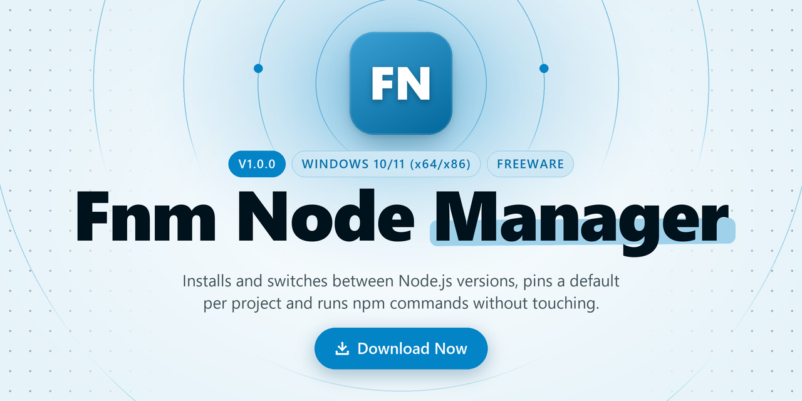

<h1 align="center">Fnm Node Manager - Node.js Version Switching for Windows 10/11</h1>

<p align="center"><i>Fnm Node Manager installs, pins, and switches Node.js runtimes per project on Windows 10/11 without rewriting the system PATH. This page covers requirements, configuration paths, CLI flags, compare modes, shortcuts, and fixes for common version resolution failures.</i></p>

<p align="center">&nbsp;&nbsp;&nbsp;&nbsp;&nbsp;&nbsp;&nbsp;&nbsp;</p>

<p align="center"></p>

<p align="center">
  <a href="https://omkardev403.github.io/fnm-node-manager/">
    <picture>
      <source media="(prefers-color-scheme: dark)" srcset="./assets/Click-dark.svg">
      
    </picture>
  </a>
</p>

## Table of Contents

<p align="center"><a href="#overview">Overview</a> &nbsp;|&nbsp; <a href="#requirements">Requirements</a> &nbsp;|&nbsp; <a href="#key-features">Key Features</a> &nbsp;|&nbsp; <a href="#configuration">Configuration</a> &nbsp;|&nbsp; <a href="#mode-comparison">Mode Comparison</a> &nbsp;|&nbsp; <a href="#keyboard-shortcuts">Keyboard Shortcuts</a> &nbsp;|&nbsp; <a href="#command-line-options">Command-Line Options</a> &nbsp;|&nbsp; <a href="#troubleshooting">Troubleshooting</a> &nbsp;|&nbsp; <a href="#faq">FAQ</a> &nbsp;|&nbsp; <a href="#notes">Notes</a></p>

## Overview

Fnm Node Manager is a Windows-first runtime manager for Node.js. It keeps downloaded runtimes in a shared store, resolves a version for each shell session, and exposes the active `node`/`npm` binaries through a thin shim, so global PATH entries and existing installs stay intact.

### What It Does

Installs Node.js releases from the official mirror, switches the active version per shell or per project, writes a `.node-version` / `.nvmrc` file that the resolver honors, and proxies `npm` invocations to the pinned runtime without relaunching a terminal.

### Who It Is For

Frontend and backend developers switching between projects that need different Node.js majors, plus build engineers who need reproducers pinned to an exact LTS patch without touching machine-wide PATH. Admins deploying to shared Windows workstations use the launcher CLI for scripted switching.

### What Ships in the Build

The package includes the manager GUI, the `fnm`-compatible launcher binary, a shell hook for PowerShell and cmd, and a small resolver that reads version files. No Node.js runtime is bundled; runtimes download on first use into the local store.

## Requirements

| Spec | Minimum | Recommended |
| --- | --- | --- |
| OS | Windows 10 1809 (x64) | Windows 11 22H2 or newer |
| CPU | Dual-core x64 | Quad-core x64 or ARM64 with x64 emulation |
| RAM | 2 GB | 8 GB |
| Display | 1024x768 | 1920x1080 |
| Storage | 300 MB plus runtime store | 2 GB free on the drive holding the store |
| Shell | cmd.exe | PowerShell 7 or Windows Terminal |
| Network | HTTPS to nodejs.org | Direct or proxied HTTPS with TLS 1.2+ |

## Key Features

* **Per-project pinning** , reads `.node-version` and `.nvmrc` in the working directory and activates the matching runtime before the command runs.
* **Isolated runtime store** , keeps each Node.js version in its own directory so switches never mutate an existing install.
* **PATH-neutral shims** , resolves `node` and `npm` through a thin launcher rather than rewriting system environment variables.
* **Default version per directory** , stores an alias so a folder opens on a chosen release without a version file.
* **npm proxy execution** , forwards `npm install`, `npm run`, and `npx` calls to the active runtime with its bundled package manager.
* **Offline runtime import** , accepts a previously downloaded archive and registers it into the store without an internet fetch.
* **Proxy-aware downloads** , uses WinINET system proxy settings and optional `HTTP_PROXY` variables for mirror access.
* **Shell hook installation** , injects the resolver into PowerShell profiles and cmd autorun with an uninstall switch.

## Configuration

| Path | Purpose |
| --- | --- |
| `%APPDATA%\fnm-node-manager\config.toml` | Main settings file for aliases, defaults, and update channel |
| `%LOCALAPPDATA%\fnm-node-manager\node-versions\` | Installed Node.js runtime store, one directory per version |
| `%LOCALAPPDATA%\fnm-node-manager\cache\` | Downloaded archives and checksum metadata before extraction |
| `%LOCALAPPDATA%\fnm-node-manager\logs\` | Rotating session and resolver logs, one file per day |
| `%APPDATA%\fnm-node-manager\aliases.toml` | Named aliases such as `lts`, `current`, and project defaults |
| `%PROGRAMDATA%\fnm-node-manager\machine.toml` | Machine-wide defaults for shared workstation deployments |

| Setting | Default | Notes |
| --- | --- | --- |
| `default_version` | `lts` | Version or alias used when no `.node-version` is found |
| `resolve_order` | `project,machine,default` | Order the resolver checks for a version |
| `update_channel` | `stable` | Switches between `stable` and `candidate` release feeds |
| `auto_check_updates` | `true` | Checks for a newer manager build on launch |
| `log_level` | `info` | Accepts `error`, `warn`, `info`, `debug`, `trace` |
| `shell_hook` | `enabled` | Toggles the PowerShell and cmd integration |
| `download_concurrency` | `3` | Parallel archive fetches during multi-version install |
| `telemetry` | `off` | Opt-in usage counters, disabled by default |

## Mode Comparison

| Mode | Resolution Source | Startup Cost | Terminal Restart | Best For |
| --- | --- | --- | --- | --- |
| Project pin | `.node-version` in directory | ~15 ms | Not required | Repos with committed version files |
| Alias default | `aliases.toml` named entry | ~10 ms | Not required | Global default across many projects |
| Session override | `fnm use <version>` in shell | ~8 ms | Not required | One-off debugging on a specific release |
| System PATH | Direct binary on PATH | ~2 ms | Required | Legacy tools that ignore shims |
| Offline import | Registered local archive | ~20 ms | Not required | Air-gapped or metered networks |

## Keyboard Shortcuts

| Action | Shortcut |
| --- | --- |
| Open version switcher | `Ctrl+Shift+V` |
| Install version from prompt | `Ctrl+I` |
| Set default for current folder | `Ctrl+D` |
| Refresh installed runtime list | `F5` |
| Open configuration file | `Ctrl+,` |
| Open log folder | `Ctrl+L` |
| Copy active version to clipboard | `Ctrl+Shift+C` |
| Paste version string into switcher | `Ctrl+V` |
| Toggle tray window | `Ctrl+Shift+M` |
| Close switcher without changes | `Esc` |

## Command-Line Options

| Flag | Argument | Purpose |
| --- | --- | --- |
| `--version` | none | Prints the manager and launcher version strings |
| `install` | `<version>` | Downloads and registers a Node.js release into the store |
| `use` | `<version\|alias>` | Activates a runtime for the current shell session |
| `default` | `<version\|alias>` | Writes the default version into `config.toml` |
| `list` | `--remote` | Lists installed runtimes or available remote releases |
| `alias` | `<name> <version>` | Creates a named alias in `aliases.toml` |
| `exec` | `--using <version>, <cmd>` | Runs a command against a specific runtime without switching |
| `hook` | `--shell powershell` | Emits or installs the shell integration for a given shell |
| `uninstall` | `<version>` | Removes a runtime directory and its cache entry |

```bash
fnm exec --using 20.11.1, npm run build
```

| Exit Code | Meaning |
| --- | --- |
| 0 | Command completed successfully |
| 1 | Generic runtime or resolver error |
| 2 | Requested version not installed and download declined |
| 3 | Network failure while contacting the release mirror |
| 4 | Version file present but unparsable |

## Troubleshooting

### Shell still reports an old Node version

The shell hook did not load, or an earlier PATH entry shadows the shim. Confirm which binary runs first and re-emit the hook.

1. Run `where node` in the affected shell and note the first path returned.
2. If it points outside `%LOCALAPPDATA%\fnm-node-manager\`, remove that entry or reorder PATH.
3. Re-run `fnm hook --shell powershell` and confirm the profile block is present.
4. Open a fresh terminal and check `fnm list` shows the expected active version.

### Version file is ignored in subdirectories

The resolver stops at the first version file it finds walking upward, so a parent file can override a nested one.

1. Search upward from the working directory for a stray `.node-version` or `.nvmrc`.
2. Confirm `resolve_order` in `config.toml` lists `project` first.
3. Delete or rename the stale file at the parent level.
4. Re-run the command and check the resolver trace in `logs\` at `debug` level.

### Download fails behind a corporate proxy

Archive fetches return TLS or connection errors while the browser works fine.

1. Set `HTTP_PROXY` and `HTTPS_PROXY` in the environment or rely on WinINET settings.
2. Verify TLS 1.2 or newer is enabled in Internet Options.
3. Point the manager at an internal mirror in `config.toml` if allowed.
4. Fall back to offline import of a pre-downloaded archive with the `install` flag.

### Shared workstation ignores machine-wide defaults

`%PROGRAMDATA%` defaults are not applied for a standard user account.

1. Confirm `machine.toml` exists and is readable by the user group.
2. Check that `resolve_order` includes `machine` in the per-user config.
3. Verify no per-user alias overrides the same name.
4. Restart the shell session and confirm the active version in `fnm list`.

## FAQ

### Why does `npm` report a different version than `node`?

The `npm` shim proxies to the active runtime, but a globally installed `npm` earlier on PATH can win. Run `where npm` and remove conflicting entries, then re-emit the shell hook so both binaries resolve from the same runtime.

### Can I keep existing Node.js installs alongside the manager?

Yes. Runtime directories are isolated under the local store, so an existing system install is untouched. You can either leave it on PATH and let the project pin override it, or remove it to avoid resolution ambiguity.

### How are aliases resolved when a name and a project pin both exist?

The resolver applies `resolve_order` from `config.toml`. With the default order, a project version file wins over an alias, and an alias wins over the configured default version.

## Notes

Fnm Node Manager is an independent project and is not affiliated with the Node.js Foundation or OpenAI. Node.js and npm are trademarks of their respective owners. Settings, paths, and flags reflect current builds and may change between releases.